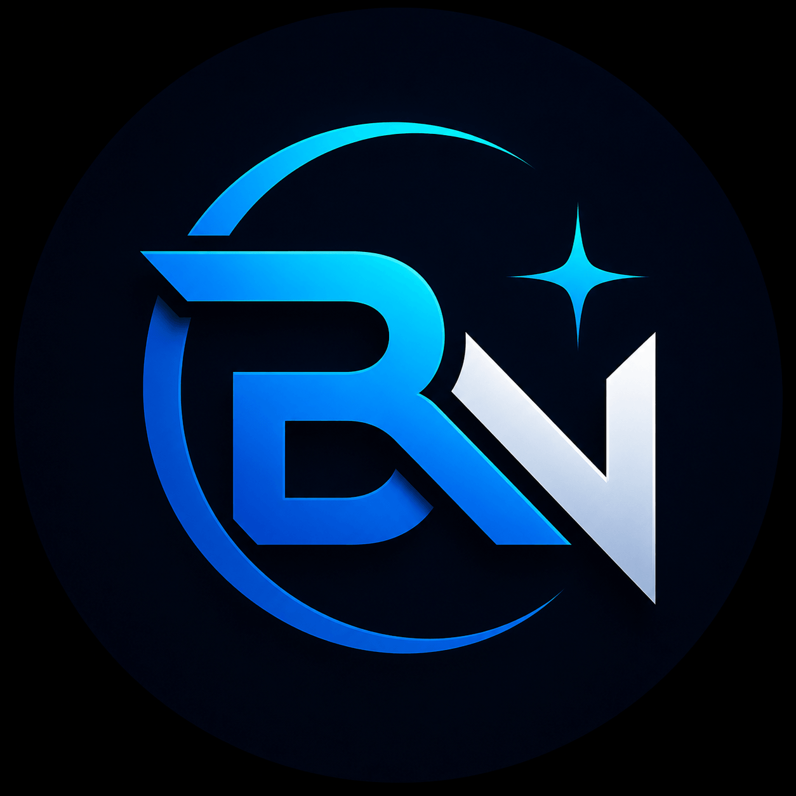

  
  <h1>¡Hola! Soy BlueNova Studio 👋</h1>
  
<strong>Estudiante de Ingeniería de Sistemas e Informática · Perú 🇵🇪</strong>

  
Aprendo y construyo proyectos de software, explorando el desarrollo web, la programación y la creación de herramientas propias.

---

## 👨‍💻 Sobre mí

- 🎓 Estudio Ingeniería de Sistemas e Informática.
- 🌱 Estoy desarrollando mis habilidades en programación y desarrollo de software.
- 🧪 Me gusta aprender creando proyectos y experimentando con nuevas ideas.
- 🗣️ Actualmente exploro tecnologías para la web y lenguajes de programación.

## 🚀 Proyectos destacados

| Proyecto | Descripción | Tecnologías / enfoque |
|---|---|---|
| [Nexis](https://github.com/BlueNovaStudio/nexis-lang-public) | Lenguaje de programación de tipado estático creado por BlueNova Studio. Incluye documentación, ejemplos y descargas de la demo. | Diseño de lenguajes · compiladores · documentación |
| [CodeWidget](https://github.com/BlueNovaStudio/code-widget) | Herramienta en Python para generar visuales de código en SVG y HTML, con resaltado de sintaxis y temas. | Python · SVG · HTML |
| [web-ui-lab](https://github.com/BlueNovaStudio/web-ui-lab) | Espacio para experimentar con interfaces web. | Desarrollo web |
| [rust-from-zero](https://github.com/BlueNovaStudio/rust-from-zero) | Repositorio para explorar y aprender Rust desde cero. | Rust |

## 🧰 Tecnologías que estoy aprendiendo

  
  
  
  
  
  
  

**Herramientas:** GitHub · Visual Studio Code · Code::Blocks

## 📊 Estadísticas de GitHub

  
  

## 📬 Contacto

- Sitio web: [BlueNova Studio](https://TU-SITIO-WEB)
- TikTok: [@bluenovastudio.dev](https://www.tiktok.com/@bluenovastudio.dev)
- GitHub: [@BlueNovaStudio](https://github.com/BlueNovaStudio)
- Correo: [bluenovastudio.dev@gmail.com](mailto:bluenovastudio.dev@gmail.com)
---

⭐ ¡Gracias por visitar mi perfil! ⭐

